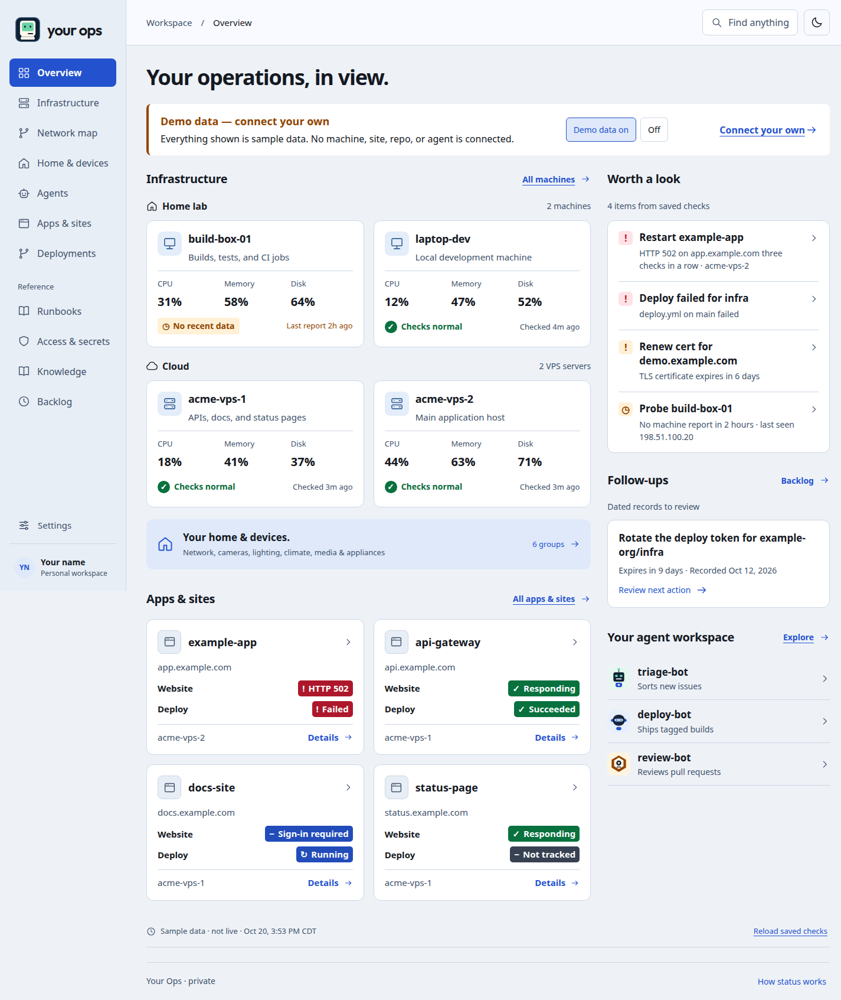

# Opsboard

See which machines, sites, deployments, and agents need attention on one dashboard. Open an app to trace a failed check to its host, its dependencies, and the steps you recorded for fixing it.

**[Run the demo locally](#quickstart)** · [Explore the sample config](switchboard.config.example.json) · [Configure your own board](#config)



<a id="features"></a>

## What it can do

### Find the next thing to check

- Start with **Worth a look**. It groups alerts by target and puts failures ahead of warnings, stale reports, and checks you explicitly flag for missing data. The overview also shows notices, dated follow-ups, and machine and app cards.
- Filter **Apps & sites** by name, failure, sign-in requirement, or health. Each app shows its website check, deploy result, host, dependencies, sign-in notes, and troubleshooting steps.
- Read the latest matching GitHub Actions run for a release branch and workflow. Queued and running releases have their own state. Pull-request runs are excluded from the release result.

### See how the fleet fits together

- Browse machines by location, check monitoring coverage, and see CPU, memory, and disk usage when a heartbeat supplies them. Keep dated recovery evidence and restore instructions with the inventory.
- Open a node on the configured network map, or use its table view. Group home devices by room or purpose and record their status in the config.
- Follow the agents’ reporting tree, inspect the latest heartbeat, and look up who owns each listed automation and when it runs.
- Press `/` to search machines, apps, repositories, agents, device groups, runbooks, and backlog items. Keep access instructions, knowledge links, and follow-ups alongside them.

### Connect and share the board

- Collect HTTP, GitHub Actions, heartbeat, SSH uptime, JSON endpoint, and static checks. Send host heartbeats from Node, shell, or PowerShell, with an optional five-minute systemd timer.
- Add machines, apps, repositories, and agents in **Settings**. Test connections, review changes, validate the draft, and copy or download the JSON. The local development server can also save it to disk.
- Serve the board as a static site with scheduled status updates. The responsive layout has light and dark themes, a populated demo, and an empty state for a new installation.

<a id="quick-start"></a>

## Quickstart

With Node.js 18 or newer and npm installed, run the following commands. The project has no package dependencies.

```bash
git clone https://github.com/jclark2496/opsboard.git
cd opsboard
npm run dev
```

Open [localhost:4173](http://localhost:4173). The **Your Ops** sample board opens with **Worth a look**, machine cards, and apps already populated. Open an app to see its website and deploy checks side by side. Turning demo data off in a fresh checkout shows the empty board.

## One design decision

**Checks run in a collector, and the board reads the results.** Opening the static dashboard does not require SSH access or a GitHub token. Each observation carries a timestamp and expiry. When the collector stops reporting, an old success becomes stale, a missing reading shows as unknown, and a recorded failure stays visible.

## Config

Start from the [example config](switchboard.config.example.json) or add your first target in **Settings**. Save the result as `switchboard.config.json` in the repo root. That file is gitignored. Set `board.demo` to `false` to use your inventory in a build. The collector and build both validate the file against the [schema](schema/switchboard.schema.json).

| Configure | Fields |
| --- | --- |
| Board identity | `board.name` for the header and title, `board.wordmark` for the rail, `board.tagline` for the overview, `board.timezone` for timestamps. |
| Appearance and access | `theme.mode` accepts `system`, `light`, or `dark`. A saved browser preference takes precedence. Set `board.auth` to `gate` when an external sign-in gate protects the site. |
| Infrastructure and apps | `machines[]` records hosts, SSH users, locations, and checks. `apps[]` connects a site to its health URL, host, dependencies, and troubleshooting steps. |
| Deploys and agents | `repos[]` records repositories, branches, workflows, and token variable names. `agents[]` sets roles, `reportsTo`, heartbeat checks, and portraits (`robot-1` through `robot-6`). |
| Inventory and notes | `network.places[]` maps nodes by place. `devices.groups[]` holds device inventory. Use `runbooks`, `access`, `knowledge`, `backlog`, `followups`, `notices`, `recovery`, and `automations` for reference material. |

A check has an adapter, options, and an optional attention flag, for example `{ "adapter": "http", "attention": true, "options": { "maxAge": "2h" } }`. Set `attention: false` to omit that check from **Worth a look**.

**Save to file** validates and downloads the draft and saves a browser copy. The default localhost server also writes it to the repo. On a static host, move the download into your build environment yourself. For a guided setup, use the [fleet setup prompt](SETUP_PROMPT.md).

## Adapters

| Adapter | Evidence it collects |
| --- | --- |
| `http` | GET the health URL. HTTP 200 or another configured expected code counts as responding. The check distinguishes sign-in (401/403), redirects, timeouts, and failures. |
| `github-actions` | Read recent workflow runs, optionally filtered by branch and workflow in the check options, and report the latest matching release run. |
| `heartbeat` | Read a timestamped report from a file or URL. An explicit `ok: false` fails the check. A report older than `maxAge` is stale. |
| `ssh-uptime` | Read Linux `/proc/uptime` as the configured user. The collector pins the host key, removes its temporary key files after the check, and records a short error category. |
| `json` | Fetch an endpoint and compare a dotted path such as `$.a.b[0]` with `okValue`. An optional request header comes from an environment variable. |
| `static` | Display a configured state and label for a target with no live check. |

The collector processes up to four targets at a time and writes `status/status.json`. A thrown check becomes `unknown` while collection continues. The available states are `ok`, `warn`, `fail`, `stale`, `unknown`, `auth`, `running`, and `redirect`. Each module implements `id`, `kinds`, `schema`, `env`, `check(target, options, ctx)`, and `demo()`. [Adapter implementations](adapters/) · [Collector](src/collector/runner.mjs)

### Heartbeat reporter

On a reporting host, point the reporter at your private receiver and supply its token from the environment.

```bash
OPSBOARD_HEARTBEAT_URL=https://ops.example.com/api/heartbeat \
OPSBOARD_HEARTBEAT_ID=acme-vps-1 \
OPSBOARD_HEARTBEAT_TOKEN="$HEARTBEAT_TOKEN_ACME_VPS_1" \
node reporter/heartbeat.mjs
```

The reporter sends `id`, `observedAt`, `ok`, and `metrics` in a bearer-authenticated POST. The local dev server accepts `/api/heartbeat` and saves `heartbeats/<id>.json` when the token matches `HEARTBEAT_TOKEN_<ID>` (uppercase, hyphens replaced with underscores) or `OPSBOARD_HEARTBEAT_TOKEN`. GitHub Pages requires a separate receiver. [Shell reporter](reporter/heartbeat.sh) · [PowerShell reporter](reporter/heartbeat.ps1) · [systemd timer](reporter/opsboard-heartbeat.timer)

The Settings **Test** button can use the localhost development API. On static hosting it can probe a public HTTP endpoint that permits browser requests or check a public GitHub repository’s visibility. SSH checks and file-based heartbeats require a collector.

## Deploy on GitHub Pages

1. Enable GitHub Pages in your fork’s repository settings and choose **GitHub Actions** as the source.
2. To supply real inventory, set the optional `OPSBOARD_CONFIG` secret to the full config JSON. The workflow writes it into the build environment. The **built site includes the configuration and collected status**. Protect the site before using real inventory.
3. The job exposes `GITHUB_TOKEN` and `SSH_KNOWN_HOSTS` to the collector. Map any additional adapter variables, such as `SSH_KEY_*` and `HEARTBEAT_TOKEN_*`, from Actions secrets into the workflow’s `env` block.
4. Push to `main` or dispatch the workflow manually. It collects, builds, and deploys. It also refreshes on an hourly schedule at minute 17. Pull requests build and upload the artifact without deploying it. [Pages workflow](.github/workflows/pages.yml)

### Any other static host

```bash
npm run collect
npm run build
```

Schedule these commands where the collector can reach your targets. Publish `dist/` after each build. It includes `status.json` and uses relative paths, so it also works under a project path such as `/opsboard/`. With the sample configuration the site stays in demo mode.

## Security

- Treat every field in the published board as visible to its readers, including hostnames, runbooks, and URLs. Put a real inventory behind your host’s access controls, Cloudflare Access, or oauth2-proxy. The `board.auth` setting documents an existing gate. Overview warns when a populated board has it set to `none`.
- Keep actual credentials in the collector environment. The config only names variables such as `tokenEnv`, `keyEnv`, `knownHostsEnv`, and `headerEnv`. Validation rejects common secret fields and token formats. Use a token with workflow run read access scoped to the intended repositories.
- Keep SSH checks, private admin URLs, and heartbeat receivers on a private network such as Tailscale or WireGuard. A hosted runner needs its own network access. Keep private keys, tokens, and SSH files out of the repository.

## Screenshots

The demo also includes [Settings](docs/screenshots/settings.png), the [empty state](docs/screenshots/empty.png), the [agent org chart](docs/screenshots/agents.png), and the [phone layout](docs/screenshots/phone.png).

## Project details

### Checks in this repo

```bash
npm test
npm run build
npm run scrub
npm run redlines
```

The tests cover validation, adapters, freshness, attention ordering, rendering, and scrubbing. The scrub check scans the working tree and Git history. The redline check scans the built site. [CI workflow](.github/workflows/ci.yml)

[](https://github.com/jclark2496/opsboard/actions/workflows/ci.yml)

### Later

The current release covers a single board and delegates sign-in to the host. Alerting, built-in accounts, Docker packaging, a first-run wizard, an adapter marketplace, an accent picker, a visual map editor, translations, and server-side config writes on static hosts are outside this version.

[Status and freshness logic](src/web/js/model.js) · [MIT license](LICENSE)
