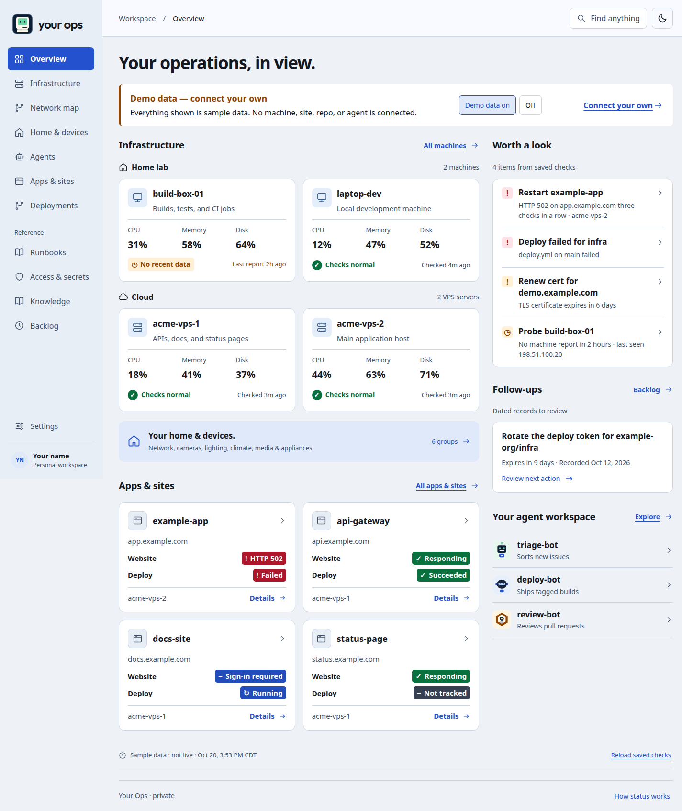
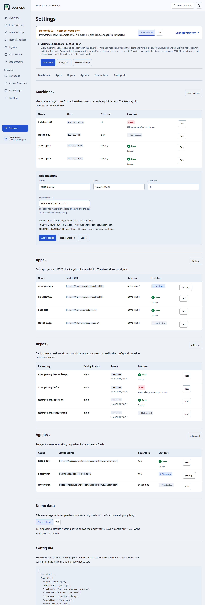
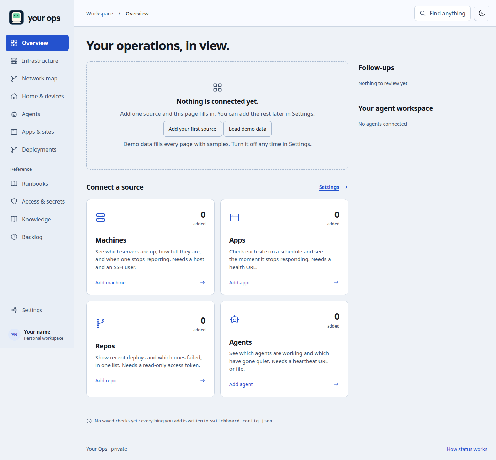
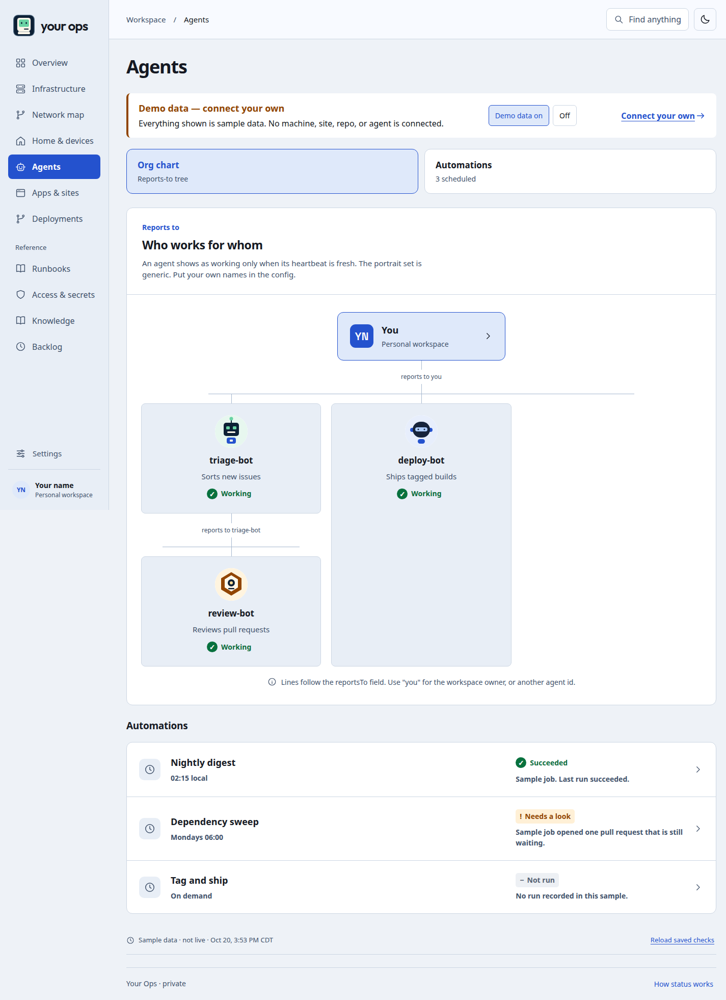
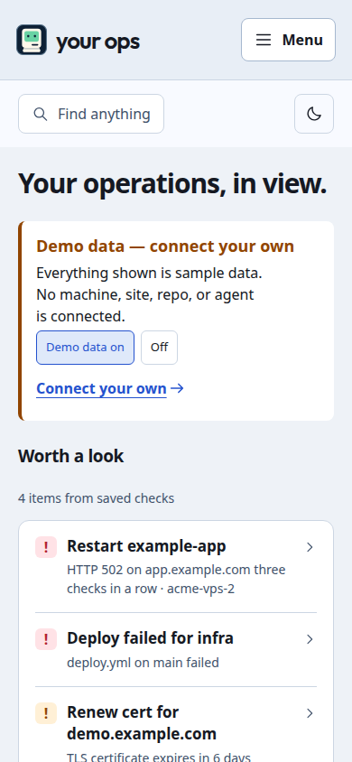

# Opsboard

[](https://github.com/jclark2496/opsboard/actions/workflows/ci.yml)

Opsboard is a plug-and-play operations dashboard. Fork it, run it, and you get a full board of sample data in under a minute. Point one JSON file at your own machines, sites, repos, and agents when you are ready.

The board name comes from the config. The sample is called **Your Ops**.



## Features

- Overview with machine cards, app health, follow-ups, and a **Worth a look** panel. Missing data is never shown as healthy.
- Infrastructure, with recovery notes and monitoring coverage.
- Network map drawn from the places in the config.
- Home & devices groups.
- Agents org chart (the reports-to tree) plus an automations list.
- Apps & sites, including a per-app dossier.
- Deployments from workflow runs. Pull request runs are ignored.
- Reference pages: Runbooks, Access & secrets, Knowledge, Backlog.
- Light and dark high-contrast themes. The choice follows the operating system until you pick one.
- Demo mode on by default, with an empty state when it is off and nothing is configured.
- Settings that edit, validate, test, and download the config in the browser.
- Status adapters behind one interface, collected by a scheduled GitHub Action into `status.json`.
- A small heartbeat reporter (Node, shell, and PowerShell) plus a systemd timer.

## Screenshots

Demo mode, light theme, desktop:

| Overview | Settings | Empty state |
| --- | --- | --- |
|  |  |  |

| Agents org chart | Phone |
| --- | --- |
|  |  |

## Quick start

Node 18 or newer. No install step and no dependencies.

```bash
git clone https://github.com/jclark2496/opsboard.git
cd opsboard
npm run dev
```

Open `http://localhost:4173`. Demo data is already on. Turn it off from the notice on Overview, or in Settings, to see the empty state.

```bash
npm test
npm run build    # writes dist/
npm run collect  # writes status/status.json from the example config
npm run scrub
```

`dist/` is a static site. Any host that serves files will do. Paths are relative, so a project site at `/opsboard/` works without a base-path setting.

## Config

Committed sample: [`switchboard.config.example.json`](switchboard.config.example.json).

Your file is `switchboard.config.json`. It is gitignored. Schema: [`schema/switchboard.schema.json`](schema/switchboard.schema.json). The build and the collector both refuse a file that does not match.

| Field | Role |
| --- | --- |
| `board.name` | Name in the header, the title, and the footer. |
| `board.wordmark` | Short brand in the rail. |
| `board.tagline` | Overview heading. |
| `board.demo` | Sample data when true. |
| `board.auth` | `none` or `gate`. `gate` means something in front of the site already requires a sign-in. |
| `board.timezone` | Shown on the source line. |
| `theme.mode` | `system`, `light`, or `dark`. A saved browser choice wins. |
| `machines[]` | Host, SSH user, place, and checks. |
| `apps[]` | URL, health URL, host id, dependencies, troubleshooting. |
| `repos[]` | `owner/name`, branch, workflow file, `tokenEnv`. |
| `agents[]` | Name, role, `reportsTo` (`you` or another agent id), `avatar` (`robot-1` … `robot-6`). |
| `network.places[]` | Map islands and the node ids inside them. |
| `devices.groups[]` | Home device groups. These rows are notes unless a json adapter feeds them. |
| `runbooks`, `access`, `knowledge`, `backlog`, `followups`, `notices`, `recovery`, `automations` | Reference content. |

Each check is `{ "adapter": "http", "attention": true, "options": { } }`. `attention: false` keeps a bad result off the Worth a look list.

**Secrets never go in this file.** Name an environment variable (`tokenEnv`, `keyEnv`, `knownHostsEnv`, `headerEnv`). The validator rejects keys shaped like `password`, `token`, or `secret`, and it rejects values that look like a token. Settings shows those names and masks anything that still looks like a secret.

On a static host, Settings edits a draft in the browser. **Save to file** validates it, stores it in this browser, downloads `switchboard.config.json`, and, when `npm run dev` is running on localhost, also writes that file on disk. GitHub Pages cannot write the file back. Copy the download into the repo only if you are comfortable publishing the hostnames, or store the JSON as the `OPSBOARD_CONFIG` Actions secret.

## Deploy on GitHub Pages

[`.github/workflows/pages.yml`](.github/workflows/pages.yml) runs on every push to `main`, on pull requests (build only), on a schedule at minute 17 of every hour, and on manual dispatch.

1. In the repository settings, enable GitHub Pages and choose **GitHub Actions** as the source.
2. The workflow collects status, builds `dist/`, uploads a Pages artifact, and deploys on pushes to `main`, on the schedule, and on manual runs. Pull requests build and upload the artifact only.
3. Optional secret `OPSBOARD_CONFIG`: the full `switchboard.config.json` contents. When it is set, the workflow writes it before collecting. It is not printed and it is not committed.
4. Optional secrets used by adapters: `GITHUB_TOKEN` (provided), `SSH_KNOWN_HOSTS`, plus any `SSH_KEY_*` and `HEARTBEAT_TOKEN_*` names from your config. Add those in the workflow `env` block when you use them.
5. `status/status.json` is produced in the job and copied into the site. It is not committed.

Until you add a real config, the published site stays in demo mode and shows the sample.

### Any other static host

```bash
npm run build
# upload dist/ to the host
```

Run `npm run collect` on a schedule wherever that host can reach your machines, and publish the resulting `status/status.json` as `dist/status.json` before or after the build. The build copies an existing `status/status.json` into `dist/` when one is present.

Docker is not part of this version.

## Adapters

An adapter is a module in [`adapters/`](adapters/) with `{ id, kinds, schema, env, check(target, options, ctx), demo() }`. `ctx` provides `fetch`, `env`, `now`, `timeoutMs`, `readFile`, `exec`, and `log`. The collector runs checks four at a time and writes `status/status.json`. A check that throws becomes `unknown`. It does not fail the job.

| Id | What it decides |
| --- | --- |
| `http` | GET a health URL. 200 (or your `expect` list) is responding. 401 and 403 are sign-in, not a crash. 3xx is a redirect. 5xx and other codes fail. Timeout fails. |
| `github-actions` | Latest workflow run on a branch. Pull request events are ignored. The token stays in `tokenEnv`. |
| `heartbeat` | Reads a JSON report from a file or a URL. Older than `maxAge` is stale. `ok: false` fails. |
| `ssh-uptime` | `ssh` as the configured user, `cat /proc/uptime`, host key pinned from `knownHostsEnv`. The key from `keyEnv` is written to a temp directory and deleted. Stderr is reduced to a short category and is not stored. |
| `json` | GET JSON and compare a dotted path (`$.a.b[0]`) with `okValue`. Optional header from `headerEnv`. |
| `static` | A fixed label for something you do not check yet. It expires slowly and does not pretend to be live. |

States are `ok`, `warn`, `fail`, `stale`, `unknown`, `auth`, `running`, and `redirect`. A success older than `expiresAfter` becomes `stale`. A failure stays a failure.

### Heartbeat reporter

On the host:

```bash
OPSBOARD_HEARTBEAT_URL=https://ops.example.com/api/heartbeat \
OPSBOARD_HEARTBEAT_ID=acme-vps-1 \
OPSBOARD_HEARTBEAT_TOKEN="$HEARTBEAT_TOKEN_ACME_VPS_1" \
node reporter/heartbeat.mjs
```

The POST body is `{ "id", "observedAt", "ok", "metrics" }` with `Authorization: Bearer`. [`reporter/heartbeat.sh`](reporter/heartbeat.sh) and [`reporter/heartbeat.ps1`](reporter/heartbeat.ps1) send the same body. [`reporter/opsboard-heartbeat.timer`](reporter/opsboard-heartbeat.timer) runs it every five minutes.

`npm run dev` accepts that POST on `/api/heartbeat` and writes `heartbeats/<id>.json` when the bearer token matches `HEARTBEAT_TOKEN_<ID>` or `OPSBOARD_HEARTBEAT_TOKEN`. GitHub Pages has no server, so point the reporter at a private collector, or let the status Action read a URL on your private network.

The browser Test button calls `/api/test` on localhost when the dev server is up. Otherwise it probes public HTTP and public GitHub from the page. SSH and file heartbeats cannot run in the browser. The button says so.

## Security

- Do not commit tokens, private keys, or the contents of `~/.ssh`. The scrub check and the post-build redline check fail the build when those show up.
- Put SSH checks, heartbeat receivers, and any private admin URL on a private network such as [Tailscale](https://tailscale.com/) or WireGuard. Do not publish them on the open internet so a hosted runner can see them. A GitHub-hosted runner is not on your tailnet unless you add that yourself.
- GitHub Pages sites are public. If the board shows real hostnames, put it behind an auth gate (Cloudflare Access, oauth2-proxy, or your host's access control) and set `board.auth` to `gate`.
- With demo off, real rows, and `board.auth` left at `none`, the overview shows a warning that the page is public.
- The status Action should use a token that can read workflow runs and nothing else. Prefer a fine-grained token stored as an Actions secret over a token with write or admin rights.
- Settings never asks for a secret value. It asks for the variable name.

## Checks in this repo

`npm test` covers the schema, the adapters, freshness, attention order, page rendering, and the scrub check. `npm run scrub` scans the working tree and `git log -p --all`. `npm run redlines` scans `dist/` after a build. Both run in [CI](.github/workflows/ci.yml).

## Later

Not in this version: a first-run wizard, a Docker image, alerting, multi-user accounts, an adapter marketplace, an accent picker, a home-network map editor, translations, and writing the config back to disk on a static host. Settings already downloads the file and the local dev server can save it.

A paste-ready prompt for filling this in against a real fleet is in [SETUP_PROMPT.md](SETUP_PROMPT.md).
